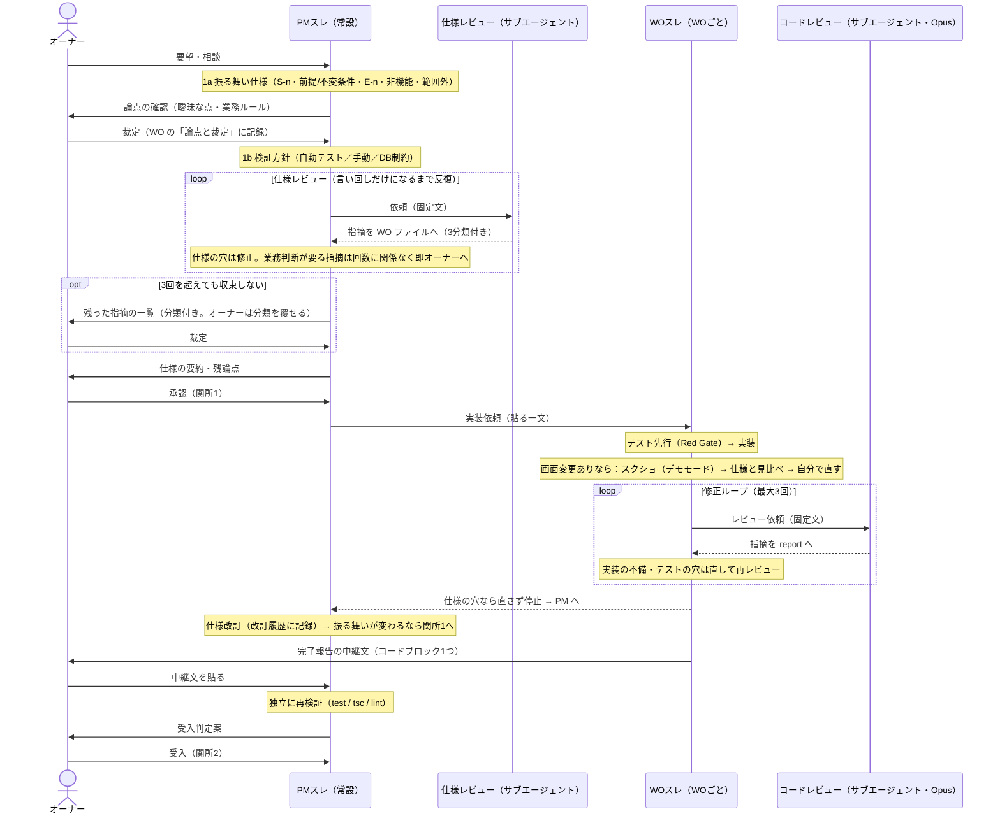

# work-orders — チーム運用（役割分担）の進め方

このフォルダは、チラトラの開発を**ひとりでも"チーム開発の作法"で回す**ための仕組み。
`restoration-reform-research` の work-order 方式を、アプリの機能追加向けに翻訳したもの。
2026-10-09 から **VSDD（Verified Spec-Driven Development）をチラトラ向けに縮めて**取り入れている（下記）。

**原則: 各ファイルが自己完結する。スレ（セッション）を立て直しても・別フォルダから開いても・
サブエージェントに渡しても、同じ状態から再開できるように書く。会話履歴ではなくファイルを正とする。**

## 役割（ロール）

| 役割 | VSDD での呼び名 | 誰が | 何をするか | ファイル |
|---|---|---|---|---|
| **オーナー** | Architect | ユーザー本人 | 仕様の**承認**（関所1）／論点の裁定／最終の**受入**（関所2） | — |
| **PM** | （進行役） | **PMスレ（常設・1本）** | 仕様化・WO起票／仕様レビューの起動／差し戻しの判断／受入時の独立検証と判定案／`CLAUDE.md`・`docs/変更管理表.md` の更新。**コードは触らない** | （専用ファイルなし＝本体スレ） |
| **実装** | Builder | **WOスレ（WOごとに1本）** | テスト先行で実装 → コードレビューを起動 → 修正ループ → 報告して**止まる** | `ROLE-implementer.md` |
| **批判役** | Adversary | **サブエージェント**（スレは立てない） | 仕様または実装の穴を突く。**直さない** | `ROLE-reviewer.md` |

### スレの数を増やさない（2026-10-09 決定）
- スレは「**PMスレ ＋ 作業中の WO の数**」だけ。レビュー専用のスレは立てない。
- 批判役は**サブエージェント**で起動する。サブエージェントは呼び出し元の会話履歴を持たずに始まるので、
  「前の文脈を引き継がない」という批判役の条件を満たす。
- レビューの中身は **WO ファイル／report ファイルに書く**。PMスレには数行の要約しか出さない（PMスレの見通しを保つため）。

## VSDD の流れ（チラトラ版）



1. **仕様化（PM）** — 原典の Phase 1（Spec Crystallization）に当たる。
   - **1a 振る舞い仕様**: 「〜のとき〜となる」の形で S-n を書く。あわせて前提・不変条件、境界ケース E-n、非機能、範囲外を書く。
   - **論点の確認**: 書いていて**業務判断が要る点**（例: 既存データの扱い、運用ルール、どこまでやるか）が出たら、
     PM が勝手に決めずにオーナーに聞く。裁定は WO の「論点と裁定」に記録する（後から「なぜこの仕様か」を追えるように）。
     技術的に決められること（実装方式など）は PM か実装が決め、オーナーには上げない。
   - **1b 検証方針**: S-n／E-n ごとに確かめ方を決める（自動テスト／テスト仕様書の手動確認／DB の CHECK 制約などで守る）。
     確かめ方が書けない項目は、仕様が曖昧なサインなので 1a に戻す。
2. **仕様レビュー（PM がサブエージェントを起動）**: 固定文（下記）で起動し、指摘は WO ファイル末尾に書かせる。
   批判役は指摘ごとに次の **3分類**を付ける。PM は分類で扱いを変える。
   - 【言い回し】→ PM が直す（または見送る）。これだけになったら**収束**。
   - 【仕様の穴（技術で解ける）】→ PM が仕様を直して再レビュー。
   - 【業務判断が要る】→ **回数に関係なく即オーナーへ**上げる。裁定は「論点と裁定」に記録。
   **3回を超えても言い回しだけに収束しない場合**は、打ち切らずに、残った指摘を一覧にしてオーナーへ上げる
   （形: `R-n／分類／内容／PM の推奨`）。オーナーは**分類を覆せる**（例: 「これは言い回しではなく業務判断」）。
   覆した分類と裁定は「論点と裁定」に記録する。
   （目的: AI 同士で直しては指摘し合う空回りを止め、判断が要るものを早くオーナーに届ける）
3. **関所1（オーナー）**: PM が仕様の要約と残った論点を示し、オーナーが承認するまで実装に渡さない。← 手戻り防止の本丸
4. **テスト先行（WOスレ）**: 自動テスト（Vitest）を先に書き、全部「失敗」することを確認（Red Gate）。
   手動確認の項目は `docs/テスト仕様書.md` に先に行を足す。
5. **実装（WOスレ）**: テストを1本ずつ通す → リファクタ → tsc / lint / test を通す。
   **画面に変更がある WO**（WO 冒頭の「画面変更: あり」）は、コードレビューの前に**画面の確認**を必ず行う（検証方針の SS-n）:
   - **デモ表示モード**で内蔵ブラウザを使って撮影する（スマホ幅 375px は必須、PC 幅は PC で使う画面のみ）。
     本番データ・実在地名を写さないため（CLAUDE.md の方針。スクショは LP 素材に流用する）。
   - AI が S-n と見比べ、差分があれば**自分で直して撮り直す**。見比べた結果を report に書く。
   - 保存先: `docs/screenshots/WO-nnn/<画面>-<mobile|pc>.png`（例: `docs/screenshots/WO-003/map-cooldown-mobile.png`）。
   - 画面をファイルとして保存できるかは未確認（2026-10-10 時点）。最初に画面変更がある WO で試し、できなければ report に書いて PM へ
     （撮影ツールの導入は別 WO で判断する）。
6. **コードレビュー（WOスレがサブエージェントを起動）**: 固定文（下記）・**モデルは実装と別（Opus）**で起動。指摘は report に書かせる。
7. **修正ループ（WOスレ）**: 指摘の分類で扱いを変える。
   - **実装の不備** → WOスレで直す → 再レビュー
   - **テストの穴** → 失敗するテストを足してから直す → 再レビュー
   - **仕様の穴** → **直さずに止まり**、report に書いて PM へ。PM が仕様を直して WO の「改訂履歴」に記録する。
     振る舞いが変わる改訂（S-n／E-n の追加・変更）は関所1（オーナー承認）を通し直す。言い回しの修正だけなら PM 判断で再開してよい
   - レビューは**最大3回**。それでも収束しなければ止まって PM へ。
8. **完了報告（WOスレ → オーナー → PM）**: report を書いたあと、WOスレは PM に貼る**中継文をコードブロック1つ**で出して止まる
   （コピーボタン1回で全部コピーできるように。説明はコードブロックの外に書く）。オーナーがそれを PMスレに貼る。形式:
   ```
   【中継】WO-nnn 完了報告
   - 報告ファイル: work-orders/WO-nnn-report.md（見る箇所: 「S-n/E-n の達成状況」「レビュー指摘」「PM に判断を求める点」）
   - 確認済み: tsc / lint / test 通過、コードレビュー n回で収束（高・中なし）、スクショ n枚（無ければ「画面変更なし」）
   - 判断してほしい点:
     1. …
     （無ければ「なし」）
   ```
   途中で止まる場合（仕様の穴・レビュー3回で収束しない 等）も同じ形で出し、1行目を「【中継】WO-nnn 停止（理由）」にする。
9. **受入（PM → オーナー）**: PM が report とレビュー指摘を読み、**test / tsc / lint を自分で再実行**（独立検証）して判定案を出す。
   **関所2**: オーナーが受入 → WO を「受入」に。変更管理表に記録。CLAUDE.md の現在地を更新してコミット。

### サブエージェント起動の固定文（補足・絞り込みを加えない）
起動する側（PM／実装）が指示文を書くと、無意識に見る範囲を絞ってしまう。だから文面を固定する。

- 仕様レビュー（PMスレが起動）:
  > `work-orders/ROLE-reviewer.md` を読んで、WO-nnn の「仕様レビュー」をしてください。
- コードレビュー（WOスレが起動。モデル: Opus）:
  > `work-orders/ROLE-reviewer.md` を読んで、WO-nnn の「コードレビュー」をしてください。

### 収束の基準（いつ止めるか）
- **仕様**: 批判役の指摘が【言い回し】だけになる（3回を超えたらオーナーが残りを裁定して収束とする）。
- **テスト**: 仕様項目 S-n・境界ケース E-n のすべてに対応するテスト（自動 or テスト仕様書の行）がある。
- **実装**: 批判役が重要度「高・中」の指摘を出せない（「低」だけなら PM 判断で受入可）。
- **検証**: `npx tsc --noEmit` / `npm run lint` / `npm test` が通る。DB 変更があれば下記「形式検証の代わり」も済み。

### 形式検証の代わり（原典の Phase 5 をチラトラ向けに置き換え）
原典は Kani / Dafny / TLA+ 等による証明を求めるが、チラトラ（Next.js + Supabase の業務アプリ）には過剰なので採らない。代わりに:
- **不変条件は DB の CHECK 制約・NOT NULL でも守る**（例: 残部 ≤ 持参）。アプリの検証だけに頼らない。
- **RLS の確認**: 追加したテーブル/ビューが anon で拒否されること（テスト仕様書 A-04 の手順）。
- **public / demo のドリフト確認**: 両スキーマに同じ DDL が当たっていること。
- 型・lint・自動テストが通ること。

### 規模による使い分け（PM が起票時に決め、WO に書く）
- **フル**: 新機能・DB 変更・認証・業務ルールが増えるもの。1〜9 すべて。
- **軽量**: 文言修正・小さな改善・基盤整備。仕様レビュー（2）とテスト先行（4）は省略可。
  **コードレビュー（6）と関所2は省略しない。** 受入基準を先に書く点も変えない。

### 追跡（トレーサビリティ）
原典の課題管理ツール（Chainlink）は使わず、**WO 内の ID の連鎖**で代用する:
`S-n（仕様項目）/ E-n（境界ケース）` → `テスト（テスト名 or テスト仕様書 No.）` → `実装（ファイル）` → `レビュー指摘（R-n）`。
テスト名・テスト仕様書の行には対応する `S-n` / `E-n` を書く。

## ファイルの決まり

- **WO ファイル**: `WO-<連番3桁>-<短いslug>.md`。`WO-TEMPLATE.md` をコピーして作る。仕様レビューの指摘は末尾に追記される。
- **報告ファイル**: `WO-<連番>-report.md`。WOスレが書き、コードレビューの指摘（R-n）と対応内容も追記される。
- **スクショ**: `docs/screenshots/WO-<連番>/<画面>-<mobile|pc>.png`。デモ表示モードで撮る（LP 素材に流用するため）。
- **状態**は WO 冒頭に書く（更新は PM）: `起票` → `仕様レビュー中` → `仕様承認` → `作業中` → `受入待ち` → `受入` / `保留`。
  （軽量コースは `仕様レビュー中`・`仕様承認` を飛ばしてよい）
- **「真実の所在」**: 仕様・現在地は `CLAUDE.md`、変更の記録は `docs/変更管理表.md`、不具合は `docs/バグ管理表.md`。
  work-orders は「作業の単位と受入の記録」。重複させず、リンクで繋ぐ。

## WOスレを始めるときに貼る一文（コピー用）
> `work-orders/WO-nnn-<slug>.md` と `work-orders/ROLE-implementer.md` を読んで作業し、報告を `work-orders/WO-nnn-report.md` に書いて止まってください。

## 出典（VSDD）
- 原典: dollspace-gay による GitHub Gist「Verified Spec-Driven Development」（2026年）。参照したのはフォーク
  https://gist.github.com/tombohub/7dac258eb09739cc6e8bdbb9addeca3f
- 新しい方法論で標準化はされていない。本書は原典の骨格（仕様→テスト先行→敵対的レビュー→収束）だけを採り、
  形式検証・専用ツール・批判役の別スレ化はチラトラの規模に合わせて置き換えている。
