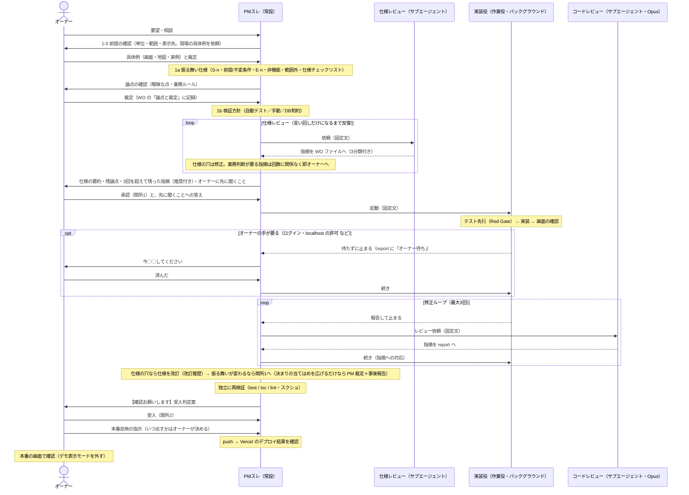

# work-orders — チーム運用（役割分担）の進め方

このフォルダは、チラトラの開発を**ひとりでも"チーム開発の作法"で回す**ための仕組み。
`restoration-reform-research` の work-order 方式を、アプリの機能追加向けに翻訳したもの。
2026-10-09 から **VSDD（Verified Spec-Driven Development）をチラトラ向けに縮めて**取り入れている（下記）。
2026-10-14 から、実装役は **PM スレが起動するバックグラウンドの作業役**が既定（WO-010 から。振り返り `vsdd-feedback.md` の 6-2 の決定）。

**原則: 各ファイルが自己完結する。スレ（セッション）を立て直しても・別フォルダから開いても・
サブエージェントに渡しても、同じ状態から再開できるように書く。会話履歴ではなくファイルを正とする。**

## 役割（ロール）

| 役割 | VSDD での呼び名 | 誰が | 何をするか | ファイル |
|---|---|---|---|---|
| **オーナー** | Architect | ユーザー本人 | 仕様の**承認**（関所1）／論点の裁定／最終の**受入**（関所2） | — |
| **PM** | （進行役） | **PMスレ（常設・1本）** | 仕様化・WO起票／仕様レビューの起動／差し戻しの判断／受入時の独立検証と判定案／`CLAUDE.md`・`docs/変更管理表.md` の更新。**コードは触らない** | （専用ファイルなし＝本体スレ） |
| **実装** | Builder | **作業役**（既定。PM スレがバックグラウンドで起動）／**別スレ**（例外。WOごとに1本） | テスト先行で実装 → 報告して**止まる**（修正ループは PM が渡す） | `ROLE-implementer.md` |
| **批判役** | Adversary | **サブエージェント**（スレは立てない。仕様レビューもコードレビューも PM が起動。別スレの WO だけ、コードレビューは WOスレが起動） | 仕様または実装の穴を突く。**直さない** | `ROLE-reviewer.md` |

### スレの数を増やさない（2026-10-09 決定。2026-10-14 に作業役を既定に）
- 実装は**作業役（既定）**: PM スレが Agent ツールでバックグラウンドに起動する。終わると PM が自動で呼び戻されるので、オーナーが中継文を貼る必要がない
  （理由: WO-001〜008 で、判断でない手作業のうち最も多かったのが中継文と一文の貼り付け〔計20回〕。`vsdd-feedback.md`）。
- **別スレ（例外）**は、作業の途中でオーナーの操作や対話が続く WO だけ（例: WO-005 のように Google Cloud・Supabase の画面をオーナーが何度も操作する／本番の DB に DDL を当てる段を一緒に見る／見た目をその場で一緒に選ぶ）。
  どちらにするかは、WO を書くときに PM が提案し、オーナーが決める（WO の「進め方」欄）。
- スレは「**PMスレ ＋ 別スレで作業中の WO の数**」だけ。レビュー専用のスレは立てない。
- 批判役は**サブエージェント**で起動する。サブエージェントは呼び出し元の会話履歴を持たずに始まるので、
  「前の文脈を引き継がない」という批判役の条件を満たす。
- レビューの中身は **WO ファイル／report ファイルに書く**。PMスレには数行の要約しか出さない（PMスレの見通しを保つため）。

## VSDD の流れ（チラトラ版）



1. **仕様化（PM）** — 原典の Phase 1（Spec Crystallization）に当たる。
   - **1-0 前提の確認（仕様を書く前・仕様レビューより先）**: 「何を1単位として数えるか」「対象の範囲（何を含め何を除くか）」「どこに表示するか」を、
     **現場の具体例**（実際の画面のスクショ、地図、実データの例を1つ）をオーナーにもらって確かめ、裁定を「論点と裁定」に記録する。
     ここが固まるまで 1a 以降に進まない（批判役も回さない）。具体例に実在の地名・本番データが写っていても、WO などの文書には書かない。
     （理由: WO-003 では単位が決まる前に仕様レビューを回し、9回中6回が後で捨てた前提に対するものになった。地図の画像1枚で収束した。`docs/振り返り/WO-003.html`）
   - **1a 振る舞い仕様**: 「〜のとき〜となる」の形で S-n を書く。あわせて前提・不変条件、境界ケース E-n、非機能、範囲外を書く。
   - **論点の確認**: 書いていて**業務判断が要る点**（例: 既存データの扱い、運用ルール、どこまでやるか）が出たら、
     PM が勝手に決めずにオーナーに聞く。裁定は WO の「論点と裁定」に記録する（後から「なぜこの仕様か」を追えるように）。
     技術的に決められること（実装方式など）は PM か実装が決め、オーナーには上げない。
   - **1b 検証方針**: S-n／E-n ごとに確かめ方を決める（自動テスト／テスト仕様書の手動確認／DB の CHECK 制約などで守る）。
     確かめ方が書けない項目は、仕様が曖昧なサインなので 1a に戻す。
   - **仕様チェックリスト**: 仕様レビューに出す前に、WO の「仕様チェックリスト」を PM が埋める（該当しないものは「該当なし」と理由）。
     WO-002・WO-003 の仕様レビューで繰り返し出た穴をまとめたもの。批判役に毎回同じ穴を指摘させないため。
   - **対象を全部数える（決まりを画面に当てる WO は必須。軽量コースでも省かない）**: デザインの決まり（44px・14px 等）を画面に当てる WO は、
     点検の一覧だけから仕様を作らず、コード・画面で対象を全部数え、数え方と件数を仕様に書く
     （理由: WO-008 は点検の一覧から仕様を作り、地図の部品とセレクトの選択肢が漏れて、実装役が2回止まった。`vsdd-feedback.md`）。
   - **オーナーに先に聞くこと**: 作業役は途中でオーナーに質問できない。画面確認のログイン・localhost の許可・使ってよい道具など、
     作業の途中でオーナーの答えや手が要ることを洗い出し、関所1 と一緒に聞いて WO に書く（無ければ「なし」。空欄では渡さない）。
2. **仕様レビュー（PM がサブエージェントを起動）**: 固定文（下記）で起動し、指摘は WO ファイル末尾に書かせる。
   批判役は指摘ごとに次の **3分類**を付ける。PM は分類で扱いを変える。
   - 【言い回し】→ PM が直す（または見送る）。これだけになったら**収束**。
   - 【仕様の穴（技術で解ける）】→ PM が仕様を直して再レビュー。
   - 【業務判断が要る】→ **回数に関係なく即オーナーへ**上げる。裁定は「論点と裁定」に記録。
   **3回を超えても言い回しだけに収束しない場合**は、打ち切らずに、残った指摘を一覧（形: `R-n／分類／内容／PM の推奨`）にして、
   **関所1 の仕様の要約にまとめて出し**、「推奨どおりでよいか」を承認と一緒に聞く（別の上程はしない）。
   オーナーは**分類を覆せる**（例: 「これは言い回しではなく業務判断」）。覆した分類と裁定は「論点と裁定」に記録する。
   （2026-10-14 から。WO-003〜007 で上程した15件は、すべて推奨どおりの裁定だった。`vsdd-feedback.md`）
   （目的: AI 同士で直しては指摘し合う空回りを止め、判断が要るものを早くオーナーに届ける）
3. **関所1（オーナー）**: PM が仕様の要約・残った論点・3回を超えて残った指摘（推奨付き）・オーナーに先に聞くことを示し、オーナーが承認するまで実装に渡さない。← 手戻り防止の本丸
   あわせて「進め方」（作業役／別スレ）もここで決める。
4. **テスト先行（実装役）**: 自動テスト（Vitest）を先に書き、全部「失敗」することを確認（Red Gate）。
   手動確認の項目は `docs/テスト仕様書.md` に先に行を足す。
5. **実装（実装役）**: テストを1本ずつ通す → リファクタ → tsc / lint / test を通す。
   **画面に変更がある WO**（WO 冒頭の「画面変更: あり」）は、コードレビューの前に**画面の確認**を必ず行う（検証方針の SS-n）:
   - **デモ表示モード**で内蔵ブラウザを使って撮影する（スマホ幅 375px は必須、PC 幅は PC で使う画面のみ）。
     本番データ・実在地名を写さないため（CLAUDE.md の方針。スクショは LP 素材に流用する）。
   - AI が S-n と見比べ、差分があれば**自分で直して撮り直す**。見比べた結果を report に書く。
   - 保存先: `docs/screenshots/WO-nnn/<画面>-<mobile|pc>.png`（例: `docs/screenshots/WO-003/map-cooldown-mobile.png`）。
   - 保存の方法と、ログイン・localhost の許可の頼み方は `ROLE-implementer.md` 手順5。
   - **オーナーの手が要るとき**（ログイン・許可など）、作業役は**待たずに止まる**（report に「オーナー待ち: ◯◯」と書く）。
     PM がオーナーに「今◯◯してください」と頼み、「済んだ」と言われたら同じ作業役に続きを渡す。別スレのときは、WOスレがオーナーに直接頼んで待つ。
6. **コードレビュー（PM がサブエージェントを起動）**: 実装役が報告して止まったら、PM が固定文（下記）・**モデルは実装と別（Opus）**で起動する。指摘は report に書かせる。
   PM は起動文に補足を加えない（実装役の考えを批判役に渡さないため）。別スレの WO だけは、従来どおり WOスレが起動する。
7. **修正ループ（PM が実装役に渡す）**: 指摘の分類で扱いを変える。PM は同じ作業役に「report の R-n に対応して」と続きを渡す。
   - **実装の不備** → 実装役が直す → 再レビュー
   - **テストの穴** → 失敗するテストを足してから直す → 再レビュー
   - **仕様の穴** → **直さずに止まり**、report に書いて PM へ。PM が仕様を直して WO の「改訂履歴」に記録する。
     振る舞いが変わる改訂（S-n／E-n の追加・変更）は関所1（オーナー承認）を通し直す。言い回しの修正だけなら PM 判断で再開してよい。
     **例外（2026-10-14 決定・案B）**: 改訂が「**承認済みの決まりの当てはめを広げるだけで、新しい業務判断を含まない**」もの
     （例: 44px・14px の決まりの対象に、漏れていた部品を足す）は、PM が裁定して再開してよい。
     そのときは改訂履歴に「案B（PM 裁定・事後報告）」と書き、**次の【確認お願いします】に一行で**オーナーに知らせる。迷ったら関所1を通す。
   - レビューは**最大3回**。それでも収束しなければ止まって PM へ。
8. **完了報告（実装役 → PM）**: 作業役は report を書いて止まる。終わると PM が自動で呼び戻されるので、**中継文は要らない**。
   作業役が PM に返すのは要約だけ（状態・tsc/lint/test・スクショの枚数・判断してほしい点）。中身は report を正とする。
   **別スレの WO** は従来どおり、WOスレが中継文をコードブロック1つで出し、オーナーが PMスレに貼る。形式:
   ```
   【中継】WO-nnn 完了報告
   - 報告ファイル: work-orders/WO-nnn-report.md（見る箇所: 「S-n/E-n の達成状況」「レビュー指摘」「PM に判断を求める点」）
   - 確認済み: tsc / lint / test 通過、コードレビュー n回で収束（高・中なし）、スクショ n枚（無ければ「画面変更なし」）
   - 判断してほしい点:
     1. …
     （無ければ「なし」）
   ```
   途中で止まる場合（仕様の穴・レビュー3回で収束しない 等）も同じ形で出し、1行目を「【中継】WO-nnn 停止（理由）」にする。
9. **受入（PM → オーナー）**: PM が report とレビュー指摘を読み、**test / tsc / lint を自分で再実行**（独立検証）して判定案を出す。
   **関所2**: オーナーが受入 → WO を「受入」に。変更管理表に記録。CLAUDE.md の現在地を更新してコミット。
10. **本番反映（PM、オーナーの指示で）**: 受入した内容の push（＝Vercel への自動デプロイ）は、**オーナーの指示で PM スレが行う**。
   実装役（作業役・WOスレ）はコミットも push もしない（関所2 を飛ばして本番に出せてしまうため。受入で検証した中身と本番に出す中身を一致させるため）。
   - push の後、PM が Vercel のデプロイ結果を確認する（例: `gh api repos/<owner>/<repo>/commits/<sha>/status` で Vercel の状態が success）。
   - オーナーが本番の画面で変更を確かめる（**デモ表示モードを外して**ログイン）。気になる表示があれば PM に伝え、不具合ならバグ管理表に記録して WO を起こす。
   - いつ出すかはオーナーが決める（受入したら即 push とは限らない）。
   - **毎回、Supabase の「Allow new users to sign up」がオフであることを確かめる**（Google ログインで未登録を拒否する唯一の守り。CLAUDE.md の方針）。

### サブエージェント起動の固定文（補足・絞り込みを加えない）
起動する側（PM／実装）が指示文を書くと、無意識に見る範囲を絞ってしまう。だから文面を固定する。

- 仕様レビュー（PMスレが起動）:
  > `work-orders/ROLE-reviewer.md` を読んで、WO-nnn の「仕様レビュー」をしてください。
- コードレビュー（PMスレが起動。別スレの WO は WOスレが起動。モデル: Opus）:
  > `work-orders/ROLE-reviewer.md` を読んで、WO-nnn の「コードレビュー」をしてください。
- 実装役の起動（PMスレが作業役としてバックグラウンドで起動）:
  > `work-orders/WO-nnn-<slug>.md` と `work-orders/ROLE-implementer.md` を読んで、作業役として作業し、報告を `work-orders/WO-nnn-report.md` に書いて止まってください。オーナーの手が要ることや仕様の穴に気づいたら、待たずに・決めずに report に書いて止まってください。コミット・push はしないでください。
- 実装役への続き（同じ作業役に SendMessage で渡す）:
  > report の「レビュー指摘（第n回）」に対応してください（ROLE-implementer 手順8）。／ オーナーが◯◯を済ませました。続きを進めてください。

### 収束の基準（いつ止めるか）
- **仕様**: 批判役の指摘が【言い回し】だけになる（3回を超えたらオーナーが残りを裁定して収束とする）。
- **テスト**: 仕様項目 S-n・境界ケース E-n のすべてに対応するテスト（自動 or テスト仕様書の行）がある。
- **実装**: 批判役が重要度「高・中」の指摘を出せない（「低」だけなら PM 判断で受入可）。
- **検証**: `npx tsc --noEmit` / `npm run lint` / `npm test` が通る。DB 変更があれば下記「形式検証の代わり」も済み。

### 形式検証の代わり（原典の Phase 5 をチラトラ向けに置き換え）
原典は Kani / Dafny / TLA+ 等による証明を求めるが、チラトラ（Next.js + Supabase の業務アプリ）には過剰なので採らない。代わりに:
- **不変条件は DB の CHECK 制約・NOT NULL でも守る**（例: 残部 ≤ 持参）。アプリの検証だけに頼らない。
- **RLS の確認**: 追加したテーブル/ビューが anon で拒否されること（テスト仕様書 A-04 の手順）。
- **public / demo のドリフト確認**: 両スキーマに同じ DDL が当たっていること。
- 型・lint・自動テストが通ること。

### 規模による使い分け（PM が起票時に決め、WO に書く）
- **フル**: 新機能・DB 変更・認証・業務ルールが増えるもの。1〜9 すべて。
- **軽量**: 文言修正・小さな改善・基盤整備。仕様レビュー（2）とテスト先行（4）は省略可。
  **コードレビュー（6）と関所2は省略しない。** 受入基準を先に書く点も変えない。
  **決まりを画面に当てる WO は「対象を全部数える」（1）を省略しない。** 軽量コースで仕様レビューを1回回すかは、作業役での WO-010 の結果を見て決める。

### 追跡（トレーサビリティ）
原典の課題管理ツール（Chainlink）は使わず、**WO 内の ID の連鎖**で代用する:
`S-n（仕様項目）/ E-n（境界ケース）` → `テスト（テスト名 or テスト仕様書 No.）` → `実装（ファイル）` → `レビュー指摘（R-n）`。
テスト名・テスト仕様書の行には対応する `S-n` / `E-n` を書く。

## DB の破壊的な操作（データの削除など）の決まり（2026-10-12 決定）
- **まず元に戻せる形で片付ける**: 削除の代わりに、架空の名前・座標への書き換え、退避用テーブルへの移動（データは残る）、論理削除で目的を果たせないか考える。
  元に戻せる操作は、オーナーの承認があれば PM・実装スレ（Claude）が実行してよい。
- **完全に消すときは、検査を組み込んだ SQL（またはバッチ）で行う**:
  - 1本の中に「確認 → 想定と違えば中止 → 実行 → 実行後の状態を検査 → 合っていれば確定」を入れ、誰が流しても同じ結果になり、想定外なら止まる作りにする。
  - 予行演習（rollback／dry-run）と本番は**同じ SQL**を流す（違いは確定するかどうかだけ）。予行演習と結果の報告は PM・実装スレが行う。
  - **本番の確定（commit）だけは人間が実行する**。Claude はデータの完全削除を、承認があっても実行しない（Claude 側の制約）。
    このため完全削除に限り、オーナーの一押しが「承認」と「実行」を兼ねる。中身の確認は予行演習と SQL の検査が受け持つので、押す人の判断は要らない。
  - 対象のスキーマ名を必ず修飾する（`demo.`／`public.`）。本番（public）への完全削除は、事前にバックアップの手段を確認する。
- **先延ばしにしない**: 消すべきデータを見つけたら、CLAUDE.md「保留中」の「削除待ち」に「何を・なぜ・いつまでに」を書く。
  PM は WO の受入のたびに削除待ちを棚卸しし、期限のものをオーナーに上げる。複数あれば1本の SQL にまとめて1回で片付ける。
  消すまでの間は、元に戻せる処置（隠す・架空にする）で害が出ないようにしておく。
- 定期的に溜まるデータ（将来の古いデータの退避など）は、保管期限を決め、レビュー済みの自動バッチに任せる（人が毎回押さない）。

## ローカルでの確認の注意
- ログイン（メールリンク・Google）の戻り先として Supabase に許可しているローカルの URL は `http://localhost:3000/auth/confirm` だけ。
  ログインまわりを確かめるときは **ポート 3000 で** `npm run dev` を起動する（`autoPort` で別の番号になったら止めて起動し直す）。

## ファイルの決まり

- **WO ファイル**: `WO-<連番3桁>-<短いslug>.md`。`WO-TEMPLATE.md` をコピーして作る。仕様レビューの指摘は末尾に追記される。
- **報告ファイル**: `WO-<連番>-report.md`。実装役（作業役・WOスレ）が書き、コードレビューの指摘（R-n）と対応内容も追記される。
- **スクショ**: `docs/screenshots/WO-<連番>/<画面>-<mobile|pc>.png`。デモ表示モードで撮る（LP 素材に流用するため）。
- **状態**は WO 冒頭に書く（更新は PM）: `起票` → `仕様レビュー中` → `仕様承認` → `作業中` → `受入待ち` → `受入` / `保留`。
  （軽量コースは `仕様レビュー中`・`仕様承認` を飛ばしてよい）
- **「真実の所在」**: 仕様・現在地は `CLAUDE.md`、変更の記録は `docs/変更管理表.md`、不具合は `docs/バグ管理表.md`。
  work-orders は「作業の単位と受入の記録」。重複させず、リンクで繋ぐ。

## 離席モード（2026-10-14 決定）
オーナーが「**離席、◯時まで**」と言ったら、PM は次のように動く（通知の仕組みは入れない）。
- **判断が要らない段は進める**: 作業役の起動・続きの受け渡し、コードレビューの起動、修正ループ、PM の独立検証、記録（WO・report・変更管理表）の更新。
- **判断点は溜める**: 関所1・関所2、論点の裁定、案B の事後報告、オーナーの手が要る操作（ログイン・許可・本番での確認）。
  これらが要る所で、その WO は止めて待つ。**push・本番反映・DB の適用・データの削除は、離席中は行わない**。
- **戻ったとき**（指定の時刻のあとに、オーナーから最初のメッセージが来たとき）、溜めた判断点を**1回にまとめて、おすすめ付き**で出す（頭に【確認お願いします】）。
- **急ぎだけ【至急】**を付けて、その場で出す（例: 本番の不具合・データが狂うおそれ・期限があるもの）。

## 確認を求める返答の印
- PM がオーナーに確認・判断を求める返答は、頭に【確認お願いします】を付ける。急ぎは【至急】。
- 案B の事後報告は、次の【確認お願いします】に一行で入れる。

## 別スレで始めるときに貼る一文（進め方が別スレの WO だけ。コピー用）
> `work-orders/WO-nnn-<slug>.md` と `work-orders/ROLE-implementer.md` を読んで作業し、報告を `work-orders/WO-nnn-report.md` に書いて止まってください。

## 出典（VSDD）
- 原典: dollspace-gay による GitHub Gist「Verified Spec-Driven Development」（2026年）。参照したのはフォーク
  https://gist.github.com/tombohub/7dac258eb09739cc6e8bdbb9addeca3f
- 新しい方法論で標準化はされていない。本書は原典の骨格（仕様→テスト先行→敵対的レビュー→収束）だけを採り、
  形式検証・専用ツール・批判役の別スレ化はチラトラの規模に合わせて置き換えている。
